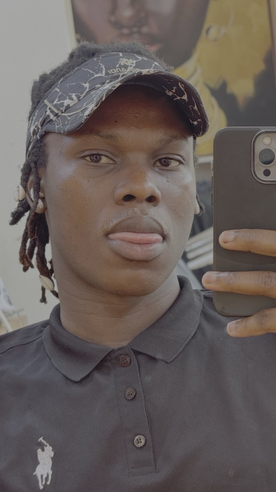

# 🚀 Mugenyi Shafik - Professional Developer Portfolio

A modern, responsive, and high-performance personal portfolio website built with clean **HTML5**, **CSS3**, and **Vanilla JavaScript**. 

Designed specifically for **Mugenyi Shafik** to highlight his foundational strengths in **HTML, CSS, and JavaScript**, while showcasing his active growth trajectory into **Python**, **Node.js**, **React.js**, and modern full-stack development.

---

## 🌟 Key Features

- **Theme Switcher**: Smooth Dark / Light mode toggle with local storage persistence.
- **Hero Typewriter Effect**: Dynamic typing animation emphasizing current and upcoming tech stacks.
- **Interactive Code Showcase**: Mockup IDE window highlighting Shafik's developer object profile with syntax highlighting.
- **Skills Matrix**: Categorized into *Core Mastered Stack* (HTML, CSS, JS, Responsive Design) and *Currently Learning* (Python, Node.js, React, Databases).
- **Interactive Roadmap**: Visual milestone timeline detailing his learning journey from fundamentals to full-stack.
- **Projects Showcase**: Interactive cards featuring realistic junior projects with working interactive live demos (Task Tracker & Weather API simulation).
- **Contact Center**: Working validated contact form, copy-to-clipboard buttons for email, and direct social links.
- **100% Mobile Responsive**: Fluid layout optimized for mobile screens, tablets, and large displays.
- **Accessible & Clean**: Semantic HTML, ARIA labels, smooth scrolling, and no heavy frameworks required.

---

## 📁 Project Structure

```
MY PORTIFOLIA/
├── index.html          # Main HTML5 document (semantic, accessible & SEO-friendly)
├── css/
│   └── style.css       # Clean CSS variables, dark/light themes, animations & layout
├── js/
│   └── script.js       # Typewriter, theme toggle, modals, validation & interactivity
├── assets/             # Place your profile images, icons, or CV PDF here
└── README.md           # Documentation and deployment instructions
```

---

## 🛠️ How to View Locally

You don't need any complex installation. Simply open `index.html` in your browser:

1. **Direct browser open**: Double-click `index.html` in your file manager or right-click and choose **Open With > Google Chrome / Safari / Edge**.
2. **VS Code Live Server** (Recommended):
   - In VS Code, install the extension **"Live Server"** by Ritwick Dey.
   - Right-click `index.html` and click **"Open with Live Server"**.
3. **Using Python local server**:
   ```bash
   python3 -m http.server 8000
   ```
   Then open `http://localhost:8000` in your browser.

---

## ✏️ How to Personalize & Customize

1. **Add Your Profile Photo**:
   - Save your photo in the `assets/` folder (e.g., `assets/shafik.jpg`).
   - In [index.html](file:///Users/mugenyishafik/Pojects/MY%20PORTIFOLIA/index.html), find the `.avatar-placeholder` in the About section and replace the icon with an `` tag:
     ```html
     
     ```
2. **Add Your Resume / CV**:
   - Save your PDF in `assets/Mugenyi_Shafik_CV.pdf`.
   - Update the CV button link in [index.html](file:///Users/mugenyishafik/Pojects/MY%20PORTIFOLIA/index.html):
     ```html
     <a href="assets/Mugenyi_Shafik_CV.pdf" download class="btn btn-outline" id="cv-btn">Download CV</a>
     ```
3. **Connect Your Real GitHub & LinkedIn Links**:
   - Search for `https://github.com/mugenyishafik` in [index.html](file:///Users/mugenyishafik/Pojects/MY%20PORTIFOLIA/index.html) and replace with your exact profile URLs.
4. **Make the Contact Form Send Real Emails**:
   - You can connect the form for free to [Formspree](https://formspree.io/) or [Web3Forms](https://web3forms.com/).
   - Just change the `<form>` opening tag in `index.html` to:
     ```html
     <form action="https://formspree.io/f/YOUR_FORM_ID" method="POST">
     ```

---

## 🚀 Free Deployment Guide

### Option 1: GitHub Pages (Free & Recommended)
1. Initialize a git repository in this folder:
   ```bash
   git init
   git add .
   git commit -m "Initial portfolio release for Mugenyi Shafik"
   ```
2. Create a repository on GitHub named `mugenyi-portfolio` or `mugenyishafik.github.io`.
3. Push your code:
   ```bash
   git remote add origin https://github.com/mugenyishafik/mugenyi-portfolio.git
   git branch -M main
   git push -u origin main
   ```
4. On GitHub, go to **Settings > Pages > Branch: main > Save**.
5. Your portfolio will be live at `https://<username>.github.io/<repo-name>/`!

### Option 2: Vercel or Netlify
- Drag and drop this folder directly into [Netlify Drop](https://app.netlify.com/drop) or import from GitHub on [Vercel](https://vercel.com) for instant global SSL hosting with 1-click deployment.

---

### 📬 Contact Details Configured
- **Email**: `shafikmugenyi523@gmail.com`
- **Location**: Kampala, Uganda (Available Globally / Remote)
- **Status**: Open to entry-level software developer roles, internships, and collaborations.

---

*Designed and engineered for Mugenyi Shafik.*
